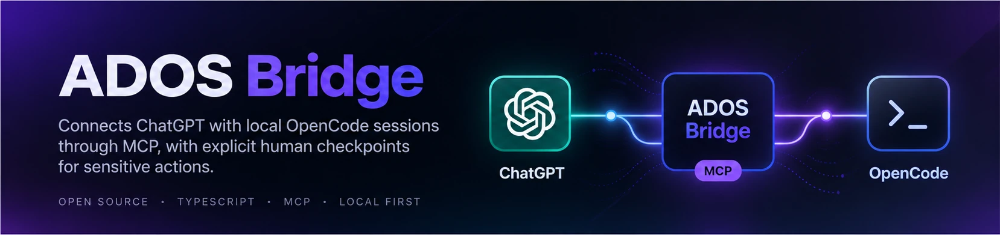
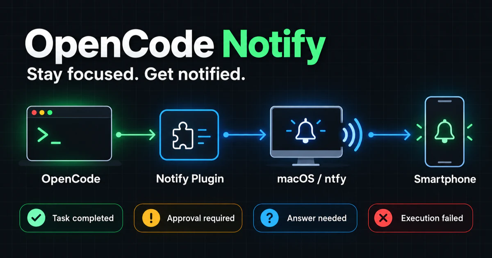
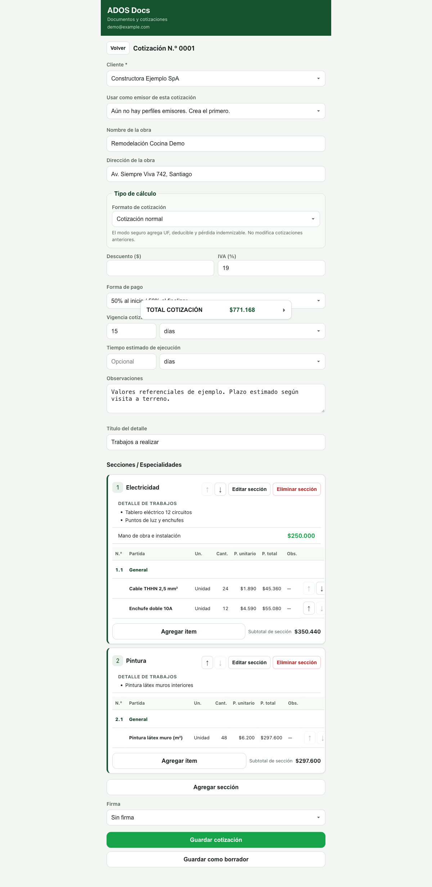

# Matías Valdebenito

I build software — mostly TypeScript products and developer tools — and learn by shipping projects in public.

## Featured Projects

### 1. ADOS Bridge

**Supervised local execution for AI-assisted development.** ADOS Bridge connects ChatGPT with local OpenCode sessions through a secure MCP bridge, while explicit human checkpoints keep sensitive actions under your control.

`TypeScript` · `Node.js` · `MCP` · `OpenCode` · `Local-first`

[View repository →](https://github.com/matiasgonzalovq/ados-bridge) · License: MIT

### 2. OpenCode Notify

**Stay focused while OpenCode works.** An open-source notification plugin for OpenCode that delivers desktop and mobile alerts when tasks finish, require approval, need user input, or encounter errors.

It supports ntfy across macOS, Linux and Windows, adds native macOS notifications through `terminal-notifier`, and coordinates plugin instances to prevent duplicate completion and error alerts.

`JavaScript` · `Node.js` · `ntfy` · `macOS` · `OpenCode`

[View repository →](https://github.com/matiasgonzalovq/opencode-notify) · License: MIT

## Other Projects

### ADOS Docs

An open-source document workspace (PWA) for creating and sharing construction quotes in CLP: clients, sections, line items, transparent calculations and PDF export. TypeScript and Vite on Firebase, with tests and CI.

[View repository →](https://github.com/matiasgonzalovq/ados-docs) · License: AGPL-3.0 · Release: v0.1.0

### Portal Talentos

An open-source talent and learning portal for exploring aptitudes and learning styles, built with React, TypeScript and Firebase.

[View repository →](https://github.com/matiasgonzalovq/portal-talentos) · License: MIT

## How I work

I learn by shipping and sharing what I build. Issues, branches and pull requests are the normal workflow, and each project above has a repository with a README, tests and CI. AI-assisted development is part of how I build, mainly with ChatGPT, OpenCode and Codex.

## Contact

GitHub: [@matiasgonzalovq](https://github.com/matiasgonzalovq)
